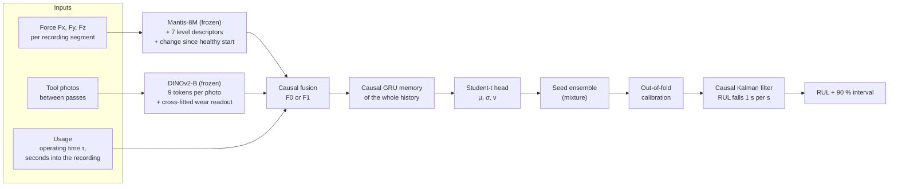
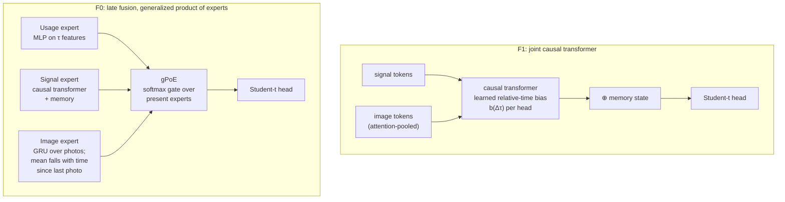
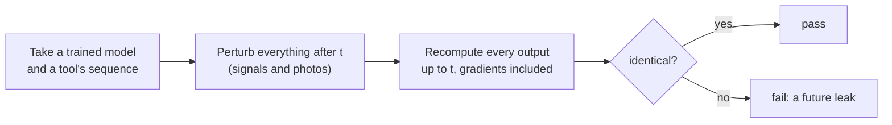
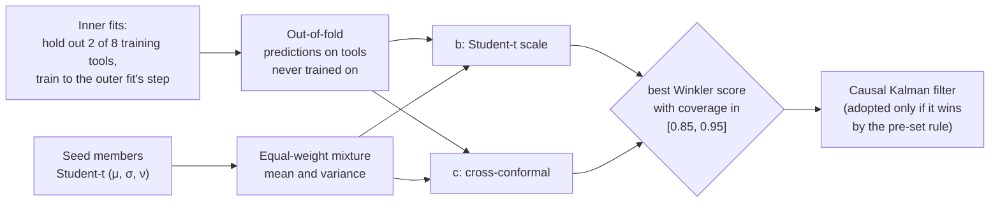
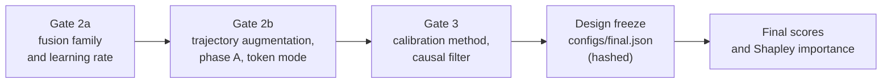
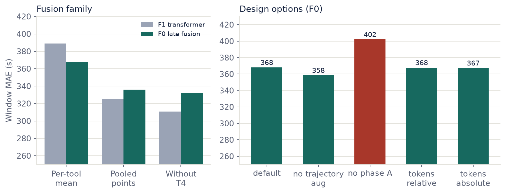
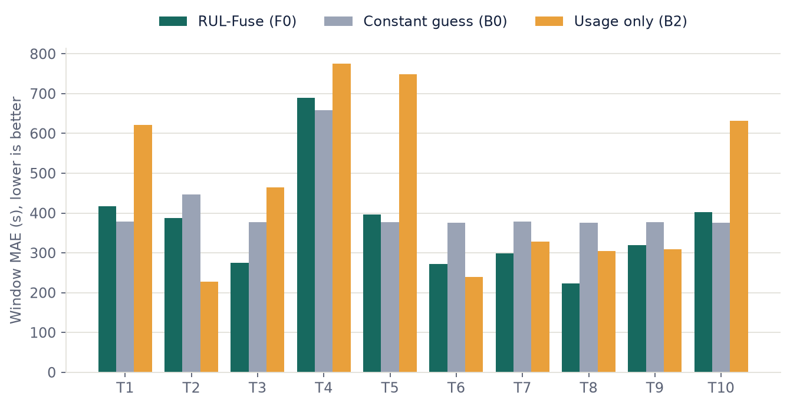

# RUL-Fuse: multimodal remaining-useful-life prediction for milling tools


-2ea44f)


RUL-Fuse predicts **how many seconds of cutting a milling tool has left**. It reads the
tool's **force signals** and its **photographs**, and returns a calibrated interval with the
point estimate, for example "≈ 640 s, 90 % between 420 and 900 s".

It is built and evaluated on the public **Nonastreda** milling dataset (10 tools run to
failure, 512 passes, 3-axis force, tool photos between passes) with a deliberately strict
protocol: every number is measured on a tool the model never saw.

<table>
<tr>
<td align="center"><b>2</b><br/>fusion families<br/><sub>transformer vs product of experts</sub></td>
<td align="center"><b>Causal</b><br/>checked by test<br/><sub>future inputs cannot change past outputs</sub></td>
<td align="center"><b>10</b><br/>leave-one-tool-out folds<br/><sub>validation tool in each</sub></td>
<td align="center"><b>500+</b><br/>automated tests<br/><sub>ruff and pyright clean</sub></td>
<td align="center"><b>1</b><br/>generic core<br/><sub>dataset-specific adapter only</sub></td>
</tr>
</table>

> **Status (November 2026).** The pipeline, both models, calibration and the evaluation
> machinery are implemented and tested, and the design is **frozen** (`configs/final.json`,
> hashed) from validation tools only. Design selection, calibration and the causal filter are
> reported below on **validation tools**. The headline test-tool scores are produced by the
> final run and are not part of this page yet.

---

## Contents

1. [The problem](#1-the-problem)
2. [Architecture](#2-architecture)
3. [Causality by construction](#3-causality-by-construction)
4. [Training objective](#4-training-objective)
5. [Uncertainty: from a distribution to a calibrated interval](#5-uncertainty)
6. [Evaluation protocol and decision gates](#6-evaluation-protocol-and-decision-gates)
7. [Results so far (validation tools)](#7-results-so-far-validation-tools)
8. [Engineering highlights](#8-engineering-highlights)
9. [Repository map](#9-repository-map)
10. [Quick start](#10-quick-start)

---

## 1. The problem

A tool replaced too early wastes money; one replaced too late ruins the part. The factory
question is: *given what the machine and the camera have shown so far, how long can this tool
keep cutting?*

- **Input:** force recordings per pass, photos of the tool between passes, and the operating
  time so far.
- **Output:** remaining useful life (RUL) in seconds, capped at a horizon **H = 1,500 s**,
  with a 90 % interval.
- **Metric:** window MAE, the mean absolute error over points whose true RUL is at most H,
  averaged over tools.
- **Baselines:** a constant guess (B0), usage-only models (B1, B2), an oracle that knows the
  measured wear (R1), and an OmniFuser architecture adapted to RUL (B6).

## 2. Architecture



The encoders are **frozen**; only small projection, fusion and head layers train (about
0.15 M parameters: d = 64, rank-16 shared projection, 2 layers, 4 heads). This keeps 10-tool training stable and makes the
whole pipeline cheap to repeat.

### The two fusion families

Both are trained and compared under the same protocol; the winner is chosen by a pre-registered
rule, not by taste.



- **F1** attends over all signal and image tokens at once.
- **F0** gives each modality its own Student-t expert and combines them with a generalized
  product of experts. The gate weights α<sub>m</sub> are a softmax over the experts that are
  actually present, so **a missing modality is handled by construction and the weights read
  directly as time-resolved modality importance.**
- **Causal memory.** A GRU runs over the tool's whole history in blocks, so a prediction can
  use what happened long ago, not only the last few recordings. A block's state is only read
  after the block is complete.
- **Relative time** enters through a learned piecewise-linear bias per attention head over
  log(1 + Δτ/10 s). It is the only time the sensing streams see; usage is a separate input.

### One dataset adapter, one generic core

Everything specific to Nonastreda (MAT/CSV parsing, wear labels, duplicate handling, photo
timing) lives in one adapter that outputs generic *units, recordings, segments, images and
failure times*. A synthetic toy adapter exercises the same core, which is how we know the
core does not secretly depend on this dataset.

## 3. Causality by construction

A prediction at time *t* may use only signals recorded and photos taken **before** *t*. In a
setting with padded batches, missing photos and sequence memory, this is easy to break
silently, so it is tested rather than assumed:



- Covered cases: padded batches, dropped photos, tools with no photo yet and truncated
  sequences.
- **A real catch.** The tests found a subtle leak in F0: in batches that mixed tools with
  different photo counts, a padded index lookup read the state of later photos. It touched
  about 81 % of the training points and never touched validation. It was fixed, a second path
  (an absent expert's scale reaching the gate) was closed, and regression tests now check every
  earlier output for later photos. The fixed model was retrained and re-evaluated, which cost
  about 30 s of apparent accuracy that had never been real.

## 4. Training objective

Remaining life can only fall as the tool is used, and the loss encodes that:

| Term | Purpose |
|---|---|
| Student-t NLL on y/H | heavy-tailed likelihood: robust and gives (μ, σ, ν) |
| Health-index readout loss | auxiliary supervision from the wear readout |
| Expert deep supervision (F0) | each expert is trained to be useful alone |
| Monotonic hinge | a later prediction should not exceed an earlier one |
| Slope consistency | below the cap, RUL falls by exactly Δτ |

The pairwise terms **detach the later prediction**: it has seen more of the tool, so the
terms only pull the earlier prediction toward it. Without the detach, one stuck earlier
prediction dragged later ones down with it (found and fixed during development).

## 5. Uncertainty



- **Out-of-fold calibration.** The scale that stretches or shrinks the intervals is fitted on
  tools the model did not train on, never on the validation tool it is scored on.
- **Three methods compared.** A scale method (b) and a cross-conformal method (c) compete by
  Winkler score; a third, fitted on the validation tool itself, is reported only as an
  in-sample reference.
- **Causal Kalman filter.** It enforces the physics that RUL falls one second per second of
  cutting, using only past predictions. Its interval scale is refitted from out-of-fold
  filter residuals.

## 6. Evaluation protocol and decision gates

- **Leave-one-tool-out.** In each of 10 folds, one tool is the **test** tool, the next tool
  is the **validation** tool that selects the epoch and scores the gates, and the other 8
  train. The test tool is never seen before the design freeze.
- **Pre-registered rules.** Every choice goes through a gate with a fixed rule written before
  the run:
  - **Rule A** adopts a change only if it gains at least 10 s on the per-tool mean and wins on
    at least 7 of 10 tools;
  - **Rule B** takes the best mean, or the cheaper option when means are within half the
    threshold.
- **Paired, tool-level statistics.** Tools are the unit of replication; intervals resample
  tools.
- **The gates:**



Fits record an identity (configuration, encoders, code version, seed, held-out tools), so an
identical fit is **copied instead of recomputed** and a stale one is refused rather than
silently mixed in.

## 7. Results so far (validation tools)

One seed, 10 validation tools, window MAE in seconds (lower is better). Constant guess 412 s,
usage-only 465 s, oracle with measured wear 307 s.

<picture>
  <source media="(prefers-color-scheme: dark)" srcset="docs/readme/decisions-dark.png">
  
</picture>

*The y-axes start at 250 s.*

| Decision | Outcome |
|---|---|
| Fusion family | **F0** wins by the rule on the per-tool mean (368 vs 389 s); F1 is ahead on pooled points, and the margin is within one-seed noise, so it is reported as such |
| Phase A (first training stage: learn the wear index before any RUL target) | **Kept**: removing it costs 34 s and loses on 8 of 10 tools |
| Trajectory augmentation | **Dropped**: no benefit (−9.5 s, CI −37 to +16) |
| Token mode | Absolute, from a tie within 0.7 s |
| Calibration | Student-t scale (b); coverage is conservative and the intervals are wide, which is reported as a limitation |
| Causal filter | **Adopted**: window MAE 361.9 s to 333.1 s, wins on 9 of 10 tools, interval coverage 0.945 |

<picture>
  <source media="(prefers-color-scheme: dark)" srcset="docs/readme/per_tool-dark.png">
  
</picture>

**Reading it honestly.**

- The model beats a constant guess on 6 of 10 tools, and on the 8 tools other than T2 and T4
  it averages 325 s against 377 s (about 14 % better).
- It loses on T1, T4, T5 and T10, tools whose lives are atypical and where usage alone also
  fails badly. T4 has only 20 window points and moves the per-tool mean by itself.
- Phase A is the only clear design effect. The same tool varies by about 80 s between arms, so
  smaller differences are not reliable at one seed.
- The calibrated intervals reach the coverage target by being wide: on most tools they span
  the whole horizon. The causal filter's interval is the informative one.

## 8. Engineering highlights

- **Deterministic and resumable.** A fit interrupted on a cluster resumes to the same weights,
  verified on CPU and on an A100 (a GPU resume check ships as a script).
- **Fit identity and reuse.** Content-addressed identity per fit; identical fits are copied
  across studies, stale ones refused (`StaleFitError`).
- **Cluster-scale orchestration.** SLURM job arrays pack several fits per GPU; an inner-fit
  array waits on the outer array; conditional studies (`requires`) skip themselves when an
  earlier gate did not select them.
- **Test suite by contract.** Unit, integration, end-to-end, adversarial (corrupted files,
  non-finite values, poisoned inputs) and real-data tests; every test declares the requirement
  it verifies. A written audit and a test review each found real bugs, all fixed with
  regression tests.
- **Leakage discipline.** Stacking leakage is removed by cross-fitting the wear readout;
  statistics are fitted on training tools only; test rows are never read by any gate.
- **Explainability by design.** F0's expert weights over time, retraining Shapley values over
  force and photos, and test-time masking are built into the evaluation plan.

## 9. Repository map

| Path | Contents |
|---|---|
| `rulfuse/core/` | Generic schema, segment store, targets, folds, normalization |
| `rulfuse/adapters/` | Nonastreda adapter (raw files to the generic schema) and a toy adapter |
| `rulfuse/features/` | Frozen encoders, feature caches, readout probes, the feature check |
| `rulfuse/models/` | F0 and F1 fusion, Student-t head, temporal losses, causal memory |
| `rulfuse/train.py`, `study.py` | Training loop, studies, gate decisions, fit reuse |
| `rulfuse/uncertainty.py`, `gate3.py` | Mixture, calibration, Kalman filter, design freeze |
| `rulfuse/shapley.py`, `final.py` | Modality importance (retraining Shapley) and final scoring |
| `rulfuse/baselines.py`, `degradation.py` | Usage-only and degradation-model baselines |
| `rulfuse/omnifuser_rul/` | Baseline B6: an OmniFuser architecture adapted to RUL |
| `configs/studies/` | The studies (gates), as JSON |
| `slurm/` | Job scripts for the Ruche cluster (Mésocentre Paris-Saclay) |
| `tests/` | Unit, integration, end-to-end, adversarial and real-data tests |
| `scripts/` | Figures, diagnostics, GPU resume check |
| `PROJECT_PLAN.md` | The research plan: decisions, gate rules, verification matrix |
| `docs/` | Exploratory analysis, the end-to-end data trace, the testing guide |

## 10. Quick start

Python 3.11. Install PyTorch for your platform, then:

```bash
pip install -e ".[test,dev]"            # core, tests, lint
pip install -e ".[encoders]"            # frozen encoders (Mantis-8M, DINOv2-B)

python -m pytest -m "not data and not weights and not gpu"   # synthetic suite, CPU only
python -m ruff check . && python -m pyright
```

The real dataset is not distributed with the code. Point `RULFUSE_DATA_ROOT` at a copy of
Nonastreda, then the command-line interface runs the pipeline step by step:

```bash
python -m rulfuse.cli build-store                 # segment store from the raw files
python -m rulfuse.cli extract-features --kind signal
python -m rulfuse.cli extract-features --kind image --kinds tool
python -m rulfuse.cli manifest --study gate2a-fix # then run its tasks on a GPU
python -m rulfuse.cli aggregate --study gate2a-fix
python scripts/readme_figures.py                  # regenerate this page's figures
```

`docs/TESTING.md` describes the test categories and what each one checks.

## Acknowledgements

The Nonastreda dataset is the work of its authors. The B6 baseline builds on an OmniFuser
reproduction (`omnifuser-reproduction`). The encoders are
Mantis-8M and DINOv2-B.
