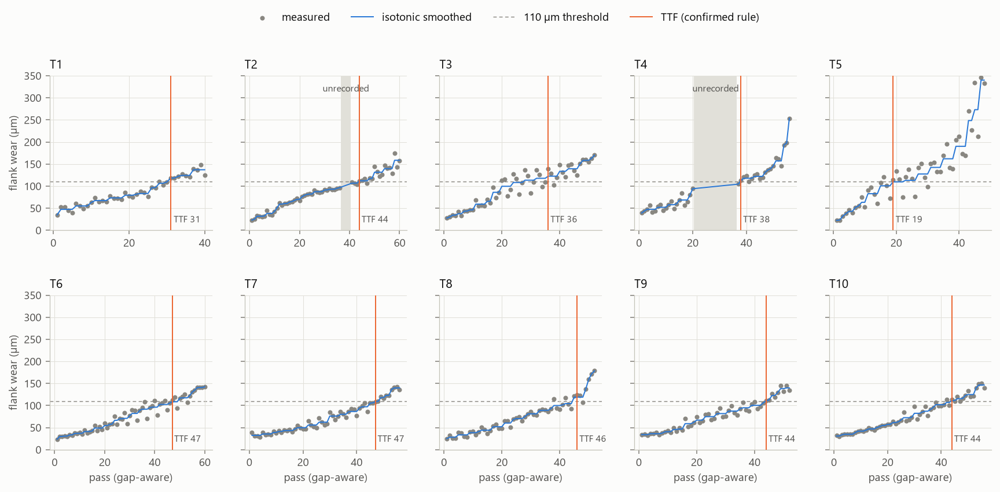
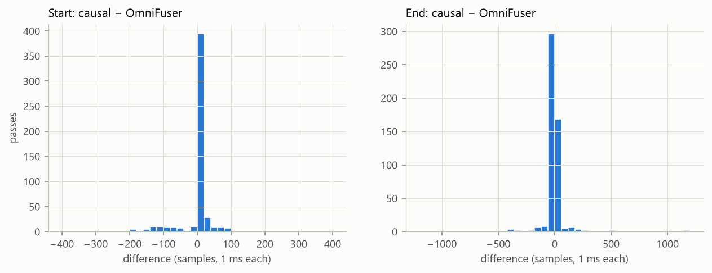
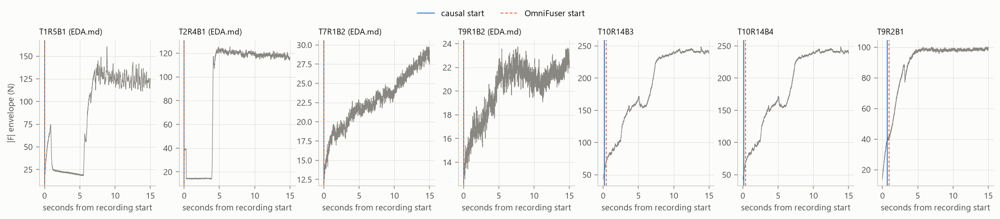
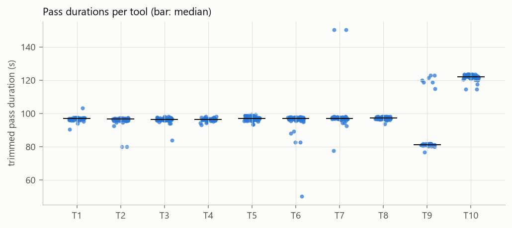
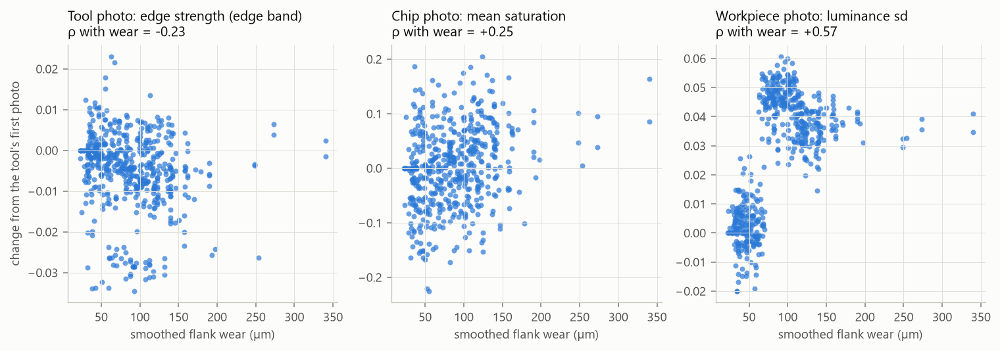
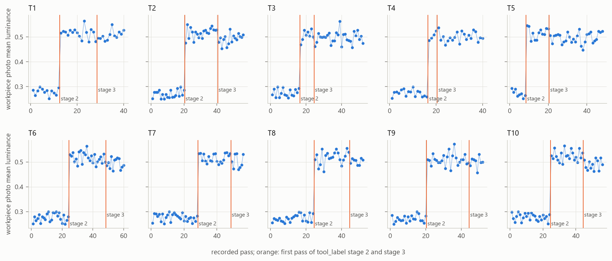
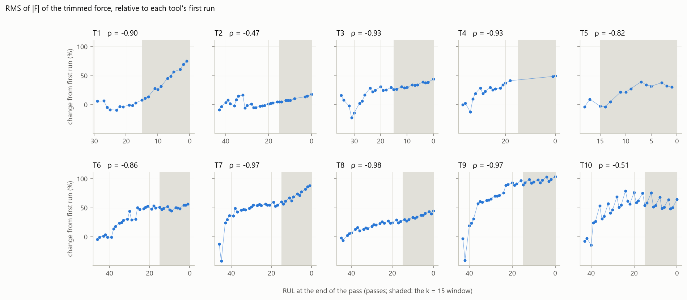
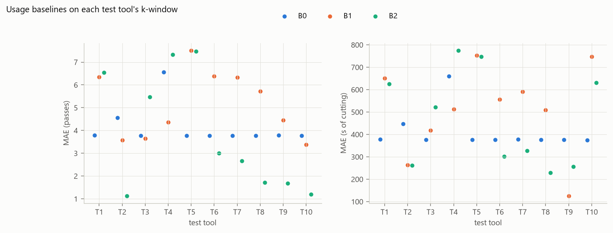

# RUL EDA and data audit (Stage 1)

This document reports Stage 1 of [PROJECT_PLAN.md](../PROJECT_PLAN.md) (§17.2): every
data fact the RUL labels depend on, the checks behind them, and the decisions they cause.
All numbers come from `scripts/eda_rul.py`, run on 2026-11-04.

```powershell
D:\RULModel\.venv\Scripts\rulfuse.exe build-force-store   # once
D:\RULModel\.venv\Scripts\python.exe scripts/eda_rul.py     # about 1 min
```

Outputs:

- `D:\RULModel\runs\eda\`: `eda_summary.json` holds every headline number; the CSV tables
  are `gaps`, `durations`, `windows_gap`, `windows_recorded`, `trim_review`, `baselines`,
  `force_indicators` and `photo_statistics`.
- The figures are in [eda_rul/](eda_rul/).

Defaults throughout: the causal trim (§5.2), the gap-aware axis (D12), duplicates attached
to the latest member (D8), and the confirmed TTF rule (D2).

## Contents

1. [Data integrity](#1-data-integrity)
2. [Unrecorded runs](#2-unrecorded-runs)
3. [Duplicated force recordings](#3-duplicated-force-recordings)
4. [Trimming](#4-trimming)
5. [Pass durations](#5-pass-durations)
6. [Photos: the workpiece photo encodes the stage label](#6-photos-the-workpiece-photo-encodes-the-stage-label)
7. [Force indicators](#7-force-indicators)
8. [TTF rules, prediction points and windows](#8-ttf-rules-prediction-points-and-windows)
9. [Usage baselines](#9-usage-baselines)
10. [Decisions and plan changes](#10-decisions-and-plan-changes)

---

## 1. Data integrity

| Check | Result |
|---|---|
| Publisher manifest (1,539 files; the unused spectrograms excluded) | 0 missing, 0 size or sha256 mismatches |
| Repository `Data/` against the publisher (515 files) | Identical; `labels.csv` differs only by CRLF line endings |
| MAT file against labels.csv (OmniFuser's checks) | 512 records; every label agrees; shapes (3, samples); all values finite |
| Force store | 512 records, 378 distinct recordings, 132 duplicate groups: the same groups as OmniFuser's |

## 2. Unrecorded runs

Three tools have missing run numbers: T1 run 1, T2 run 10, and T4 runs 6-9.

**The test.**

- If the tool cut through *k* missing runs, its mean wear rises across the gap by about
  *k* + 1 run-to-run steps.
- If it did not cut, the rise is about one step.
- The step is the median rise between consecutive recorded runs: over the whole tool
  ("global") and within 3 runs of the gap ("local").

| Tool | Missing | Wear before → after (µm) | Jump (µm) | Ratio, global | Ratio, local | Expected if cut | Expected if not |
|---|---|---|---|---|---|---|---|
| T2 | Run 10 | 93.9 → 108.2 | 14.3 | 1.64 | **2.41** | 2 | 1 |
| T4 | Runs 6-9 | 73.8 → 115.4 | 41.7 | **5.61** | **5.61** | 5 | 1 |

- **Both gaps match "the tool kept cutting".** T4's ratio of 5.6 is far from 1.
- **T1's run 1** cannot be tested; nothing comes before it. Its first recorded run has
  mean wear 46.2 µm. The other tools' first runs range from 27.5 to 46.7 µm (median
  31.6 µm), so T1 probably cut one run before its first recording, but T4 also starts
  at 47 µm. This leading gap changes no RUL target either way; it would only shift
  T1's elapsed time by 4 passes.



*Figure 1. Measured and isotonic-smoothed flank wear per tool on the gap-aware axis, with
the unrecorded runs shaded and the confirmed TTF marked.*

**Decision (confirmed by you on 2026-11-04):** the gap-aware axis (D12).
Interior gaps count as unrecorded cutting; T1's leading run is not counted.

- **Gap duration.** The median of the tool's recorded passes *before* the gap. This
  corrects the plan, whose "tool median" would have used later passes.
- **What changes on this axis:** T4's TTF moves from pass 22 to 38, and T2's from 40 to 44.

## 3. Duplicated force recordings

| | Count |
|---|---|
| Duplicate groups | 132: 127 of B3 + B4, 4 of B1 + B2, 1 of B1-B4 |
| Force-missing passes (D8: the recording goes to the latest member) | 134 of 512 (26 %): 128 in block 3, 5 in block 1, 1 in block 2 |
| Force-missing prediction points before the TTF | 951 of 3,747 (25 %) |

Every group has distinct tool, chip and workpiece photos and distinct flank wear, so the
passes happened. Only the force file was copied. A quarter of the prediction points
therefore have no force of their own, nearly always in block 3. Every evaluation reports
them separately (plan §10.1).

## 4. Trimming

| Check | Result |
|---|---|
| The vendored OmniFuser rule against OmniFuser's own `records.csv` | Identical on **512 of 512** passes |
| Causal start within 200 samples of OmniFuser's (acceptance P2: ≥ 95 %) | **99.4 %**: accepted |
| Exactly equal starts | 31.6 % (median absolute difference 1 sample) |
| End difference | Median 2 samples; largest 1,144 samples (1.1 s) |
| Duration difference | Median −0.003 s; largest 1.3 s |



*Figure 2. Start and end differences between the causal and OmniFuser trims (clipped at
±400 and ±1,200 samples).*

**Every case reviewed.** The three passes that differ by more than 200 samples (T10R14B3
and T10R14B4, one shared recording, and T9R2B1) start with a slow entry ramp. Both rules
start inside the ramp, 0.26-0.32 s apart. The causal reference (the first 5 s) is lower
there than OmniFuser's (the first 5 % ≈ 6 s), so it starts earlier. This is negligible
against 10 s segments.

The four passes that OmniFuser's `EDA.md` §5 flags (T1R5B1, T2R4B1, T7R1B2, T9R1B2) get
exactly the same bounds under both rules, start 0, as documented there.



*Figure 3. The first 15 s of each reviewed pass: force envelope, causal start (blue) and
OmniFuser start (orange).*

## 5. Pass durations

| Tool | Median (s) | 10-90 % (s) | Range (s) |
|---|---|---|---|
| T1-T8 | 96.5-97.4 | about 95-98 | 50.2 (T6) to 150.4 (T7) |
| T9 | **81.1** | 80.6-118.4 | 76.9-122.9 |
| T10 | **122.2** | 120.7-123.5 | 114.5-123.6 |



*Figure 4. Trimmed pass duration per tool; the bar is the median.*

T9 cuts mostly 81 s passes, with a few of about 120 s; T10 cuts 122 s passes. The cutting
conditions or path lengths likely differ by tool (open question 4 of the plan). This is
why the passes and the seconds windows differ: T9 has 121 window points in passes and 148
in seconds, T10 181 and 147.

## 6. Photos: the workpiece photo encodes the stage label

Global photo statistics:

- **Tool photos:** mean luminance, its sd, edge strength, saturation, blue share; the
  edge band, rows 0.30-0.85.
- **Chip photos:** the same statistics.
- **Workpiece photos:** luminance, sd and edge strength only. They are single-channel
  greyscale; a first version of the script reported a "blue share" for them that only
  tracked brightness, now removed.

| Statistic (relative to the tool's first photo) | ρ with smoothed wear (pooled) |
|---|---|
| Tool: edge strength / saturation | −0.23 / +0.20 |
| Chip: edge strength / blue share | +0.39 / +0.48 |
| Workpiece: luminance / luminance sd | **+0.64 / +0.57** |



*Figure 5. One statistic per photo type against smoothed wear, pooled over tools.*

**The workpiece correlation is not wear.**

- In every tool, the workpiece photo's mean brightness sits at 0.27-0.28 for all of
  `tool_label` stage 1.
- It jumps to 0.50-0.52 at exactly the first run of stage 2 and stays there. Inside a
  stage there is no consistent trend with wear.



*Figure 6. Workpiece photo brightness per recorded pass; orange lines mark the first pass
of `tool_label` stage 2 and stage 3.*

**The systematic check (`rulfuse.audit.stage_steps`).**

- `tool_label` changes only at a run's first block. The check computes, for every run
  boundary, the step in a statistic's run mean.
- A wear-following statistic rises over many boundaries. A statistic tied to the stage
  label jumps at the stage boundary.

| Statistic | Stage 1→2 is the largest step (tools) | Share of range | Stage 2→3 is the largest (tools) | Share of range |
|---|---|---|---|---|
| Workpiece luminance | **10 / 10** | **0.96** | 0 / 10 | 0.09 |
| Workpiece luminance sd | **10 / 10** | **0.90** | 0 / 10 | 0.21 |
| Workpiece edge strength | 5 / 10 | 0.82 | 5 / 10 | 0.80 |
| Chip blue share | 1 / 10 | 0.25 | 6 / 10 | 0.46 |
| Chip luminance, edge strength, saturation | 0-1 / 10 | 0.24-0.34 | 0 / 10 | 0.16-0.29 |
| Tool photo (luminance, edge strength, saturation, blue share) | 0-1 / 10 | 0.11-0.14 | 0 / 10 | 0.05-0.14 |
| Force: RMS of \|F\|, Fx, Fy, Fz_rel | 0 / 10 | 0.03-0.10 | 0-1 / 10 | 0.04-0.07 |

**Reading.**

- **The workpiece photographs encode the stage label.** Their appearance changed exactly
  when the annotated stage changed: at stage 2 in brightness and texture, and at stage 3
  in texture. This looks like an acquisition change (lighting, exposure, or a new
  workpiece surface per stage), not wear.
- **A model given workpiece photos could read the stage off the exposure.** That is a
  shortcut to the label-like `tool_label`, and it would not transfer to a factory.
- **The chip photo's blue tint** rises mostly at stage 3 (6 of 10 tools). That fits
  hotter chips from a duller tool, but it could also be acquisition; it needs the same
  check on the encoder features.
- **Tool photos and force show no such step.** They change gradually, as physical wear
  should.

**Decision (default, educated guess):**

1. **Workpiece photos stay a candidate modality,** but each image is standardized
   (zero-mean, unit-variance luminance per image) before encoding. That removes the
   exposure step.
2. **Gate 1 adds this stage-step probe as a leakage test for every photo type,** run on
   the encoder's PCA features (the first components) and on the wear readout. A photo
   type passes if its largest run-boundary step falls on a stage boundary in at most 3 of
   10 tools (the force and tool photos sit at 0-1).
3. **A failing type** is excluded from the headline model and the Shapley study, and
   reported as a leakage demonstration.
4. **Answered (2026-11-04):** the Nonastreda paper does not describe a change in how
   workpiece photos were taken, so the cause stays unknown and the leakage probe decides.

## 7. Force indicators

Per recorded pass with force:

- **Indicators,** on the causally trimmed force:
  - RMS of Fx, Fy, Fz, Fz_rel (Fz minus its mean over the first second of the pass) and
    |F|;
  - the band energy of |F| in 0-50, 50-150, 150-300 and 300-500 Hz (Welch).
- **"Relative"** means the change from the mean of the tool's first 4 recorded passes.
- **Correlations:** against RUL at the pass end before the TTF, and against smoothed wear
  over all passes.

| Indicator | ρ with RUL, per tool (median) | ρ with RUL, pooled, relative | ρ with wear, pooled, relative | ρ with wear, pooled, absolute |
|---|---|---|---|---|
| RMS of \|F\| | **−0.92** | −0.47 | 0.59 | **0.70** |
| RMS of Fx | −0.92 | −0.46 | 0.57 | 0.69 |
| RMS of Fy | −0.76 | −0.57 | **0.69** | 0.68 |
| Band 0-50 Hz | −0.87 | **−0.59** | 0.66 | 0.60 |
| RMS of Fz (raw) | −0.02 | −0.02 | 0.10 | 0.11 |
| RMS of Fz_rel | −0.19 | −0.17 | 0.28 | 0.29 |
| Bands above 50 Hz | −0.25 to +0.03 | −0.17 to −0.01 | −0.04 to 0.27 | 0.18 to 0.41 |



*Figure 7. RMS of |F| relative to each tool's first run, against RUL at the pass end; the
k = 15 window shaded.*

**Findings.**

- **The force tracks wear strongly within each tool.** The per-tool median ρ with RUL is
  −0.92 for the RMS of |F|. T2 and T10 are weaker (−0.47, −0.51).
- **Across tools it is weaker** (pooled ρ −0.46 to −0.59). A force level does not map
  onto the same RUL on every tool, which is the cross-tool gap the model must close.
- **Raw Fz carries no wear information** (ρ ≈ 0), as OmniFuser found (F3). Its
  drift-corrected version Fz_rel carries some (ρ 0.28 with wear). This supports keeping
  Fz and adding Fz_rel (D4); Gate 1 decides the derived channels.
- **Relative versus absolute is mixed.** For |F| and Fx the *absolute* level relates
  better to wear across tools (0.70 against 0.59); for Fy and the 0-50 Hz band the
  relative one does. This is evidence for the Gate-2b option "absolute + relative tokens".
  The default (relative) stays until that gate decides by its rule.

## 8. TTF rules, prediction points and windows

TTF pass under each rule (gap-aware axis):

| Rule | T1 | T2 | T3 | T4 | T5 | T6 | T7 | T8 | T9 | T10 | Mean ± sd |
|---|---|---|---|---|---|---|---|---|---|---|---|
| **Confirmed (D2)** | 31 | 44 | 36 | 38 | 19 | 47 | 47 | 46 | 44 | 44 | 39.6 ± 8.5 |
| Literal first dulled | 31 | 44 | 20 | 38 | 16 | 24 | 47 | 27 | 44 | 42 | 33.3 ± 10.6 |
| Smoothed wear ≥ 110 µm | 31 | 44 | 28 | 38 | 23 | 50 | 49 | 45 | 44 | 44 | 39.6 ± 8.8 |
| `tool_label` = 3 | 29 | 45 | 25 | 37 | 21 | 49 | 49 | 45 | 45 | 45 | 39.0 ± 9.8 |
| Dulled from here on | 31 | 48 | 39 | 38 | 31 | 54 | 49 | 50 | 44 | 46 | 43.0 ± 7.5 |

On the recorded axis only T2 and T4 change: confirmed 40 and 22, so 37.6 ± 9.9.

Per tool, under the defaults:

| Tool | TTF pass (record) | Smoothed wear at TTF (µm) | Cutting time to TTF (s) | Unrecorded passes before TTF | Pre-TTF points | Force-missing points | Window points, passes / seconds |
|---|---|---|---|---|---|---|---|
| T1 | 31 (R9B3) | 118.3 | 3,000 | 0 | 308 | 90 | 150 / 155 |
| T2 | 44 (R11B4) | 112.2 | 4,203 | 4 | 393 | 99 | 111 / 116 |
| T3 | 36 (R9B4) | 122.6 | 3,463 | 0 | 355 | 89 | 151 / 156 |
| T4 | 38 (R10B2) | 112.6 | 3,657 | 16 | 216 | 49 | **20 / 20** |
| T5 | 19 (R5B3) | 109.7 | 1,827 | 0 | 188 | 50 | 151 / 156 |
| T6 | 47 (R12B3) | 108.5 | 4,472 | 0 | 458 | 118 | 151 / 154 |
| T7 | 47 (R12B3) | 108.8 | 4,543 | 0 | 465 | 119 | 151 / 155 |
| T8 | 46 (R12B2) | 119.1 | 4,474 | 0 | 459 | 110 | 151 / 154 |
| T9 | 44 (R11B4) | 110.9 | 3,837 | 0 | 379 | 96 | 121 / 148 |
| T10 | 44 (R11B4) | 111.3 | 5,367 | 0 | 526 | 131 | 181 / 147 |
| **All** | 39.6 ± 8.5 | 108.5-122.6 | | 20 | **3,747** | **951** | **1,338 / 1,361** |

The confirmed rule lands at 108.5-122.6 µm of smoothed wear on every tool, which matches
the dataset's 110 µm "dulled" threshold.

## 9. Usage baselines

Settings: k-window, segment ends; the 8 training tools of each fold; elapsed time causal
(D14). The values are means over the 10 test tools.

| Baseline | Gap-aware: MAE / RMSE, passes | Gap-aware: MAE / RMSE, seconds | Recorded axis: MAE, passes / seconds |
|---|---|---|---|
| B0 window-aware constant | 4.13 / 4.64 | 412 / 463 | 3.78 / 377 |
| B1 mean TTF − elapsed | 5.17 / 5.65 | 513 / 562 | 5.78 / 560 |
| **B2 conditional residual life** | **3.82 / 4.31** | **468 / 526** | 4.01 / 480 |



*Figure 8. Each test tool's k-window MAE for B0 (blue), B1 (orange) and B2 (aqua).*

**Findings.**

- **The bar of S1** is 3.82 passes and 468 s (B2).
- **In seconds the window-aware constant beats B2.**
- **B2's empirical 90 % intervals under-cover badly:** 0.42 coverage in passes, 0.50 in
  seconds. Eight training tools cannot describe the spread of residual life, so a usage
  rule is also over-confident. Winkler scores to beat (S2): 49.4 passes and 5,388 s.
- **Per tool,** the usage rules fail most on T1, T4 and T5 (MAE 6.5-7.5 passes). T5 and
  T1 have the shortest lives (TTF 19 and 31); T4's window is the thin one after its gap.

## 10. Decisions and plan changes

| # | Finding | Decision (default or educated guess) | Plan sections updated |
|---|---|---|---|
| E1 | T2 and T4 kept cutting through their missing runs (§2) | Gap-aware axis D12, confirmed by you (2026-11-04); gap duration from earlier passes | D12, §2.5, §3.1 |
| E2 | Causal trim agrees with OmniFuser's on 99.4 % of passes; every disagreement reviewed (§4) | P2 accepted; the causal trim is the default | §5.2, §15 P2 |
| E3 | The workpiece photo's appearance steps at the stage boundaries (§6) | Per-image standardization; Gate-1 stage-step leakage probe for every photo type; exclusion if it fails | D4, §2.6, §6.2, §15 P9, §19 |
| E4 | Raw Fz carries no wear information, Fz_rel some (§7) | Keep all channels plus Fz_rel (D4); Gate 1 decides the derived channels | – (confirms the plan) |
| E5 | Absolute force levels relate to wear across tools at least as well as relative ones (§7) | Default unchanged (relative); flagged for the Gate-2b token option | §6.8 note |
| E6 | Exact baseline values with the causal trim: B1 5.17 / 513 s; B2 3.82 / 468 s; B2 intervals cover 0.42 / 0.50 (§9) | Numbers synced into the plan; S2 bar set | §1, §2.7 |
| E7 | 951 of 3,747 points (25 %) are force-missing (§3) | Reported separately in every evaluation | §2.4 |
